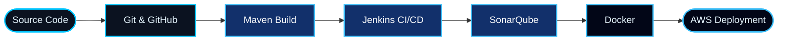

## Hi there 👋
 <div align="center">


<br/>


<br/><br/>

<a href="YOUR_LINKEDIN_URL">

</a>
<a href="mailto:YOUR_EMAIL">

</a>
<a href="https://github.com/YOUR_GITHUB_USERNAME">

</a>

</div>


<div align="center">

## 👩‍💻 ABOUT ME

</div>

<table>
<tr>
<td width="58%" valign="top">

### Hello, I'm Pranjali Ingawale! 👋

I'm a **Computer Science Engineering Graduate (2025)** passionate about software development, cloud technologies, and DevOps.

I have learned the MERN stack and developed a Food Delivery Application using React, Node.js, Express.js, and MongoDB.

Currently, I'm expanding my technical knowledge in DevOps, cloud computing, automation, and deployment technologies through hands-on practical learning.

- 💻 Frontend development using **HTML, CSS, JavaScript, and React**
- ⚙️ Backend development using **Node.js and Express.js**
- 🍃 Database management using **MongoDB and SQL**
- ☁️ Exploring cloud computing with **AWS**
- 🔄 Version control using **Git and GitHub**
- 🚀 Learning CI/CD with **Jenkins and Maven**
- 🐳 Exploring containerization with **Docker**
- ☸️ Learning container orchestration with **Kubernetes**
- 🛡️ Exploring code quality using **SonarQube**

</td>
<td width="42%" valign="top">

```bash
$ whoami

pranjali-ingawale

$ cat profile.yml

name:       Pranjali Ingawale
role:       Aspiring DevOps Engineer
education:  Computer Science Engineering
year:       2025
location:   Pune, India

interests:
  - Software Development
  - DevOps & Cloud Computing
  - CI/CD Automation
  - Backend Development

$ echo $STATUS

OPEN_TO_OPPORTUNITIES
```

</td>
</tr>
</table>

> 🎯 **Career Goal:** Looking for opportunities to apply my technical knowledge, gain industry experience, and grow as a software and DevOps professional.


<div align="center">

## 🔄 MY DEVOPS LEARNING JOURNEY

</div>




<div align="center">

## 🛠️ TECHNICAL SKILLS

</div>

<div align="center">


</div>

| Domain | Technologies |
|:---|:---|
| Frontend Development | HTML, CSS, JavaScript, React |
| Backend Development | Node.js, Express.js |
| Database | MongoDB, SQL, SQLite |
| Programming Languages | JavaScript, Python, Java |
| Cloud Computing | AWS |
| Version Control | Git, GitHub |
| CI/CD & Build Tools | Jenkins, Maven |
| Code Quality | SonarQube |
| Containers & Orchestration | Docker, Kubernetes |
| AI & Machine Learning | TensorFlow, CNN, OpenCV |
| Development Tools | VS Code, Git Bash, Postman, Apache Tomcat |


<div align="center">

## 🚀 FEATURED PROJECTS

</div>

<table>
<tr>
<td width="50%" valign="top">

### 🍔 Food Delivery Application

A full-stack food delivery application developed using the MERN stack.

**Highlights**

- Interactive frontend using React.
- Backend APIs using Node.js and Express.js.
- MongoDB database integration.
- Food ordering application functionality.

**Technologies**


</td>
<td width="50%" valign="top">

### 🔐 ViolentEye – Automated Violence Detection System

An AI-based application designed to detect violent activities in video footage using deep learning and computer vision.

**Highlights**

- Real-time violence detection using CNN.
- Video processing using OpenCV.
- Desktop interface developed using Tkinter.
- SQLite-based authentication and data management.
- Automated alert generation.

**Technologies**


</td>
</tr>
</table>

<div align="center">

<a href="https://github.com/YOUR_GITHUB_USERNAME?tab=repositories">

</a>

</div>


<div align="center">

## ☁️ DEVOPS & CLOUD PRACTICE

</div>

Currently developing hands-on knowledge in:

- Git and GitHub workflows, branching, merging, and pull requests.
- AWS EC2 and S3 fundamentals.
- Linux commands and server management.
- Maven project builds and WAR packaging.
- Jenkins CI/CD pipeline fundamentals.
- SonarQube code quality analysis.
- Docker containerization fundamentals.
- Kubernetes architecture and deployment fundamentals.


<div align="center">

## 📊 GITHUB ANALYTICS

</div>

<div align="center">

<a href="https://github.com/YOUR_GITHUB_USERNAME">

</a>

<a href="https://github.com/YOUR_GITHUB_USERNAME">

</a>

<br/><br/>


</div>


<div align="center">

## 📈 CONTRIBUTION GRAPH


</div>


<div align="center">

## 🌱 CURRENTLY LEARNING


</div>


<div align="center">

## 🤝 LET'S CONNECT

**I'm interested in software development, cloud computing, DevOps, and continuous learning.**

Feel free to connect and collaborate!

<a href="YOUR_LINKEDIN_URL">

</a>

<a href="mailto:YOUR_EMAIL">

</a>

<a href="https://github.com/YOUR_GITHUB_USERNAME">

</a>

<br/><br/>


</div>
<!--
**pranjaliingawale/pranjaliingawale** is a ✨ _special_ ✨ repository because its `README.md` (this file) appears on your GitHub profile.

Here are some ideas to get you started:

- 🔭 I’m currently working on ...
- 🌱 I’m currently learning ...
- 👯 I’m looking to collaborate on ...
- 🤔 I’m looking for help with ...
- 💬 Ask me about ...
- 📫 How to reach me: ...
- 😄 Pronouns: ...
- ⚡ Fun fact: ...
-->
